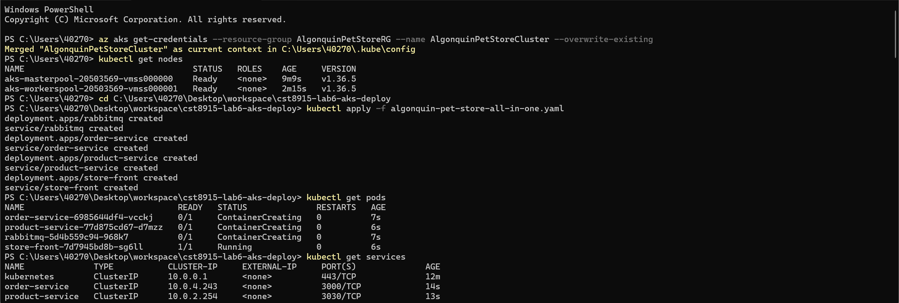
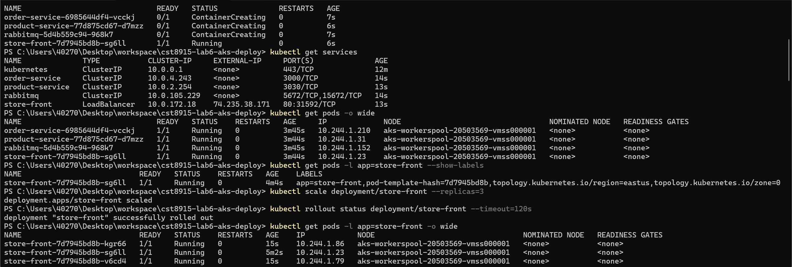
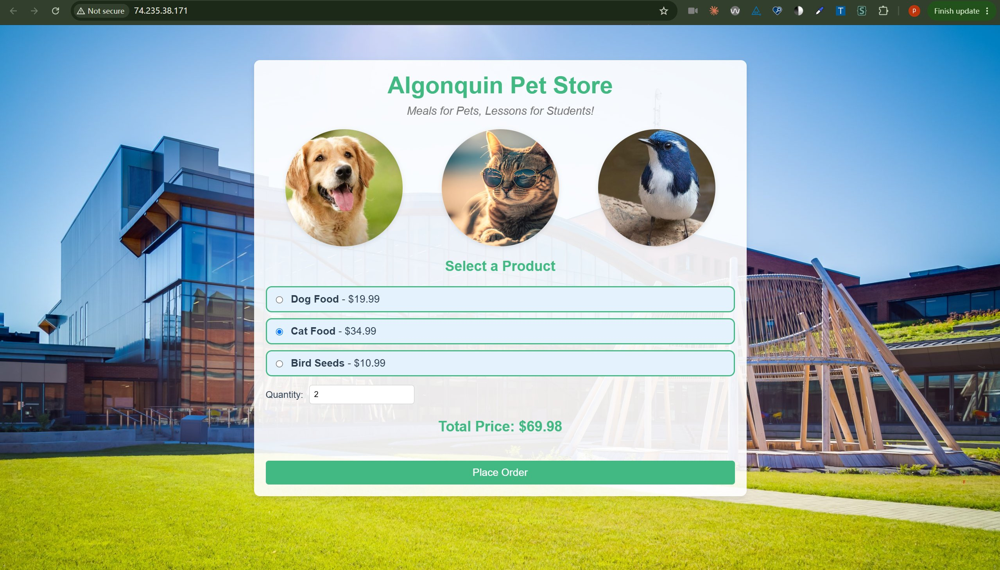
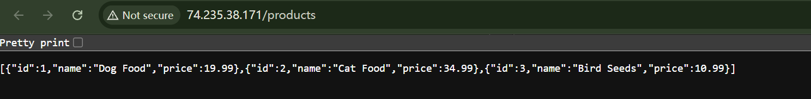
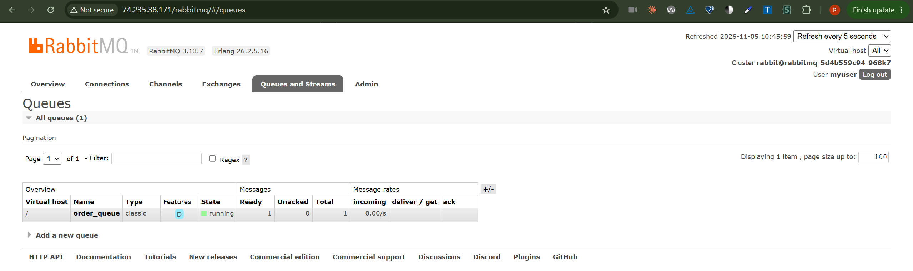
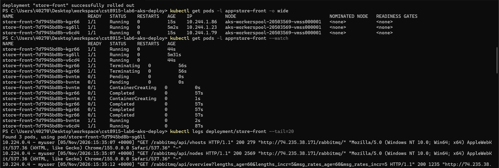
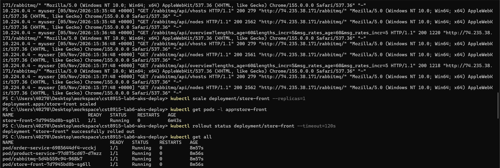
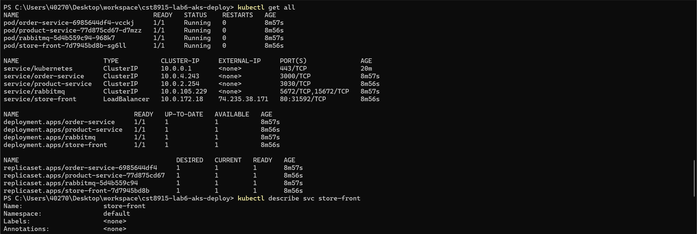
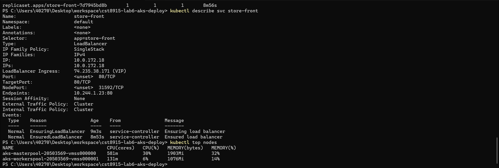

# CST8915 Lab 6: Deploy Algonquin Pet Store to Azure Kubernetes Service (AKS)

| Student Name | Student ID | Course | Semester |
|---|---|---|---|
| Peng Wang | 041107730 | CST8915 Full-stack Cloud-native Development | Fall 2026 |

🎥 [Watch Demo Video](VIDEO_LINK)

---

## 1. Demo Video

The demo shows the deployed app on the AKS cluster, in this order.

The cluster and its two node pools:

```bash
kubectl get nodes
```

The four Pods and the Services, including the external IP of `store-front`:

```bash
kubectl get pods -o wide
```

```bash
kubectl get services
```

Open the Store Front at `http://<EXTERNAL-IP>`, then open `http://<EXTERNAL-IP>/products`.

Place an order on the website. A browser GET on `/orders` returns 404 because the Order Service accepts POST there, so the order is checked in the queue:

```bash
kubectl exec deployment/rabbitmq -- rabbitmqctl list_queues name durable messages
```

Open `http://<EXTERNAL-IP>/rabbitmq/` and show `order_queue` under Queues and Streams.

## 2. Lab Tasks: Updating API Endpoints

All paths share one IP address because `store-front` is the only Service of type `LoadBalancer`, and its Pod runs NGINX as a reverse proxy. The `store-front-L6` Dockerfile copies [`nginx.conf`](https://github.com/ramymohamed10/store-front-L6/blob/main/nginx.conf) into the image.

| Path | NGINX sends the request to | Why |
|---|---|---|
| `/` | Vue files in `/usr/share/nginx/html` | The website itself is served by this Pod. |
| `/products` | `http://product-service:3030/products` | The internal Service name resolves inside the cluster. |
| `/orders` | `http://order-service:3000/orders` | The internal Service name resolves inside the cluster. |
| `/rabbitmq/` | `rabbitmq:15672`, with `/rabbitmq` removed from the path | The dashboard expects paths that start at `/`. |

The backend Services are `ClusterIP`, so they have no public address and are reached only through this proxy.

## 3. Screenshots

### Step 2: Create the AKS cluster

Resource group, Canada Central:


Cluster Basics, top of the page, before the region changed to East US:


Cluster Basics, bottom of the page, before the region changed to East US:


D2as_v4 is not available to this subscription in Canada Central, so the cluster moved to East US:


`masterpool`, System mode, 1 node of D2as_v4:


`workerspool`, User mode, 1 node of D2as_v4:


Review + create, region East US:


Deployment complete:


### Step 3: Deploy the application

Credentials, nodes and `kubectl apply`:



Services, Pods on their nodes (7A), and scaling to three replicas (7B):



Services and ingresses in the portal, with the external IP of `store-front`:


Store Front at the external IP:



Product Service through `/products` on the same IP:



RabbitMQ dashboard at `/rabbitmq/`, one queue and one message after the order:


`order_queue` is durable (D) and holds the order:



Deleting a Pod and its replacement (7C), then the logs (7D):



Back to one replica (7E):



### Lab Tasks: `kubectl` commands from the cheat sheet

`kubectl get all`:



`kubectl describe svc store-front` and `kubectl top nodes`:



---

## Submission Details

| Item | Value |
|---|---|
| Cluster region | East US, because Standard_D2as_v4 is not available to this subscription in Canada Central |
| Resource group region | Canada Central |
| Node pools | `masterpool` (System) and `workerspool` (User), each 1 node of Standard_D2as_v4 |
| Manifest | `algonquin-pet-store-all-in-one.yaml` |

GenAI declaration: As permitted for labs in this course, Claude (Anthropic) was used to explain the steps, check portal settings and terminal output, and draft this README. The portal steps, commands and demo recording were done by the student.
