# CST8915 Lab 6: Deploy Algonquin Pet Store to Azure Kubernetes Service (AKS)

| Student Name | Student ID | Course | Semester |
|---|---|---|---|
| Peng Wang | 041107730 | CST8915 Full-stack Cloud-native Development | Fall 2026 |

🎥 [Watch Demo Video](VIDEO_LINK)

---

## 1. Demo Video

### 1.1 Show the Nodes

```bash
kubectl get nodes
```

### 1.2 Show the Pods

```bash
kubectl get pods -o wide
```

### 1.3 Show the Services

The `EXTERNAL-IP` of `store-front` is the address used in the next steps.

```bash
kubectl get services
```

### 1.4 Open the Store Front

Open http://74.235.38.171 in the browser.

### 1.5 Open the Products API

Open http://74.235.38.171/products in the browser.

### 1.6 Check the Queue Before the Order

```bash
kubectl exec deployment/rabbitmq -- rabbitmqctl list_queues name durable messages
```

### 1.7 Place an Order

On the Store Front, select Cat Food, set the quantity to 2, and click Place Order. The order goes through `POST /orders`, so opening `/orders` in the browser returns 404.

### 1.8 Check the Queue After the Order

The message count increases by one.

```bash
kubectl exec deployment/rabbitmq -- rabbitmqctl list_queues name durable messages
```

### 1.9 Show the Queue in RabbitMQ

Open http://74.235.38.171/rabbitmq/#/queues in the browser and log in with the credentials from the handout. `order_queue` shows the same message count.

## 2. Lab Tasks: Updating API Endpoints

All paths share one IP address because `store-front` is the only Service of type `LoadBalancer`, and its Pod runs NGINX as a reverse proxy. The `store-front-L6` Dockerfile copies [`nginx.conf`](https://github.com/ramymohamed10/store-front-L6/blob/main/nginx.conf) into the image.

| Path | NGINX sends the request to | Why |
|---|---|---|
| `/` | Vue files in `/usr/share/nginx/html` | The website itself is served by this Pod. |
| `/products` | `http://product-service:3030/products` | The internal Service name resolves inside the cluster. |
| `/orders` | `http://order-service:3000/orders` | The internal Service name resolves inside the cluster. |
| `/rabbitmq/` | `rabbitmq:15672`, with `/rabbitmq` removed from the path | The dashboard expects paths that start at `/`. |

The backend Services are `ClusterIP`, so they have no public address and are reached only through this proxy.

## 3. Screenshots

### 3.1 Create the AKS Cluster

#### 3.1.1 Resource Group

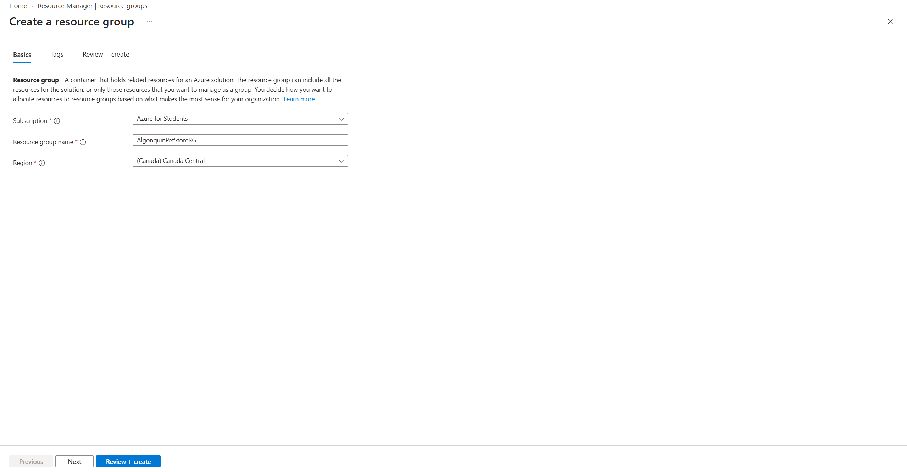

#### 3.1.2 Cluster Basics, Top

The region changed to East US after this capture.

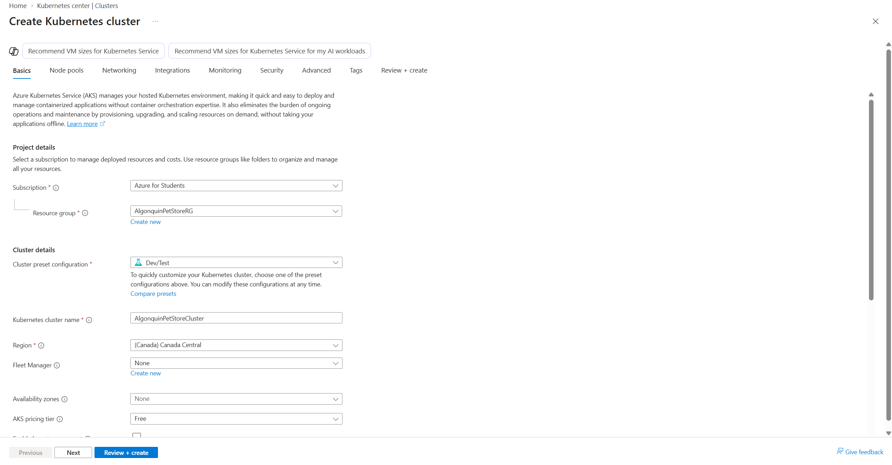

#### 3.1.3 Cluster Basics, Bottom

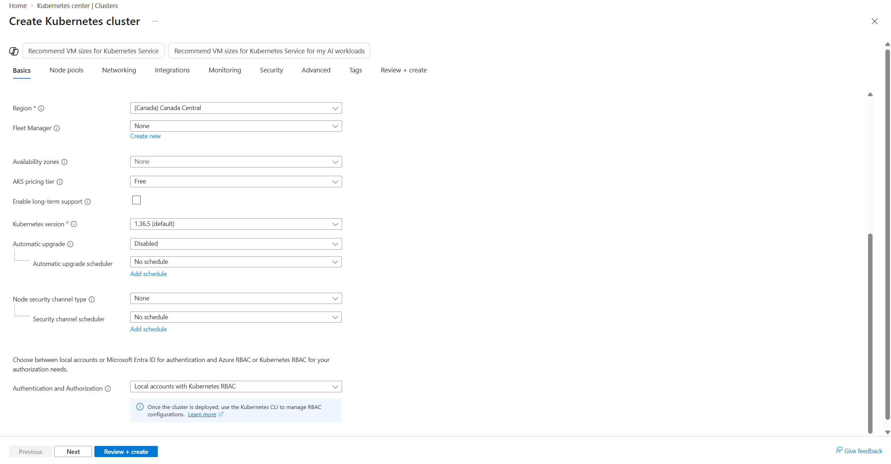

#### 3.1.4 D2as_v4 Not Available in Canada Central

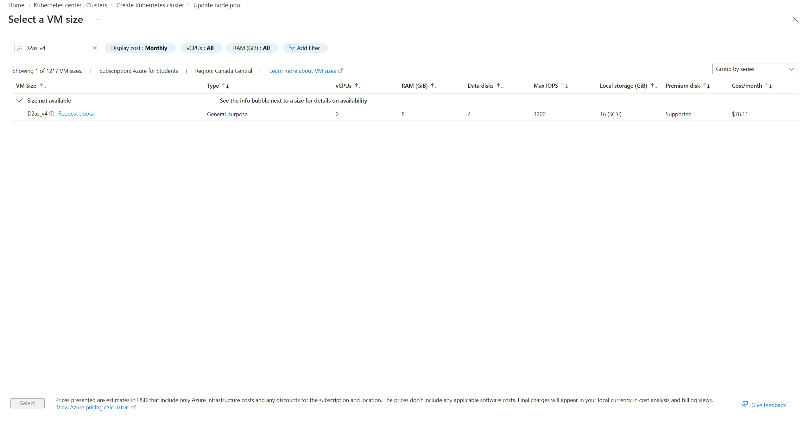

#### 3.1.5 masterpool

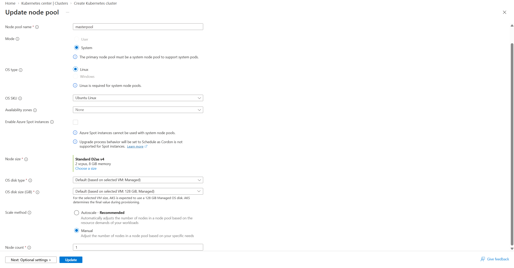

#### 3.1.6 workerspool

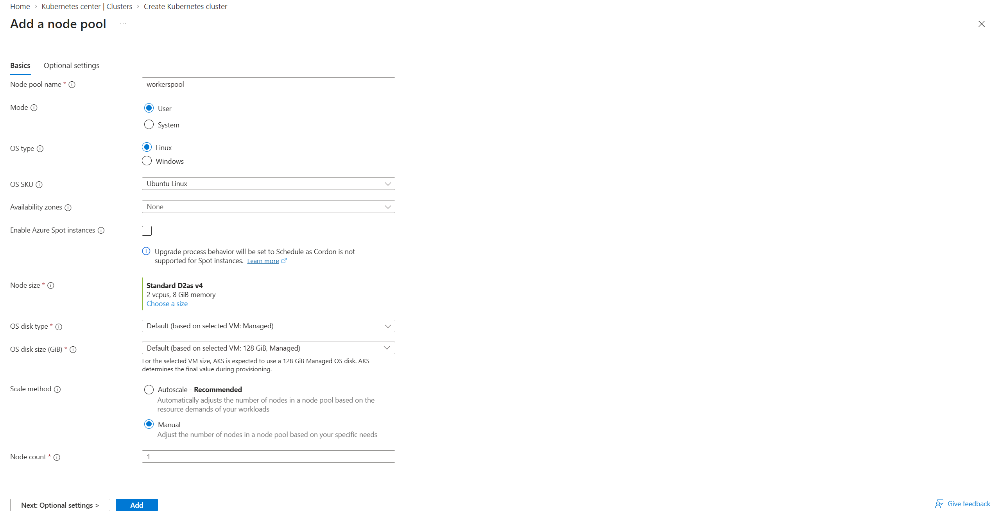

#### 3.1.7 Review + Create

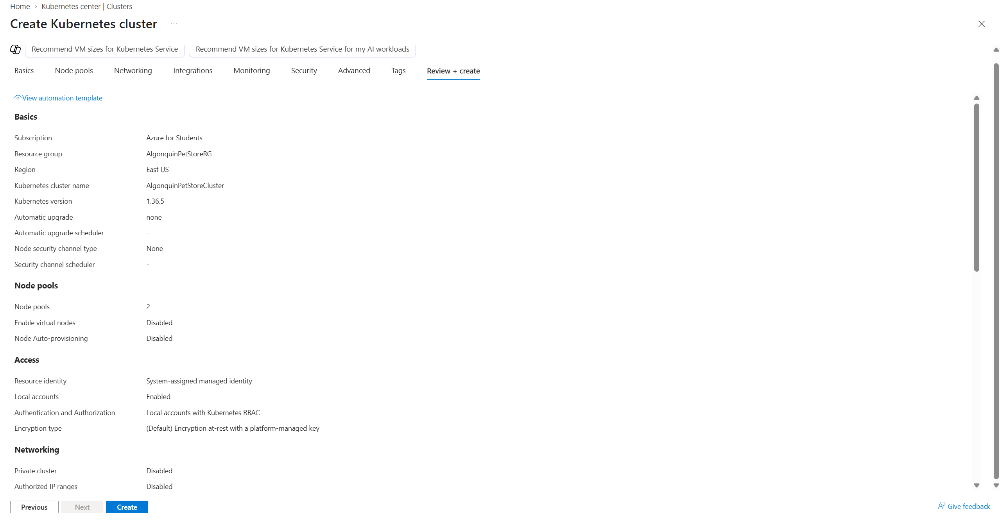

#### 3.1.8 Deployment Complete

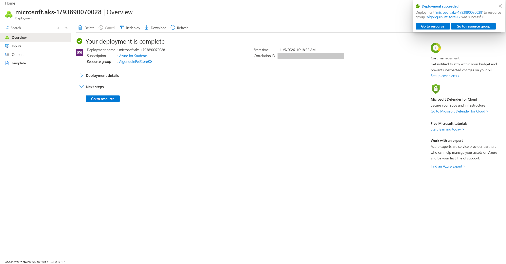

### 3.2 Deploy the Application

#### 3.2.1 `az aks get-credentials`

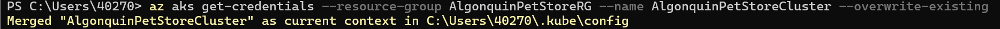

#### 3.2.2 `kubectl get nodes`

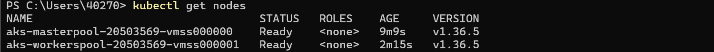

#### 3.2.3 `kubectl apply`

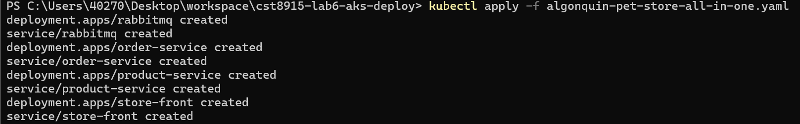

#### 3.2.4 `kubectl get pods`

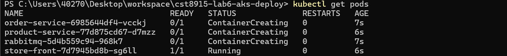

#### 3.2.5 `kubectl get services`

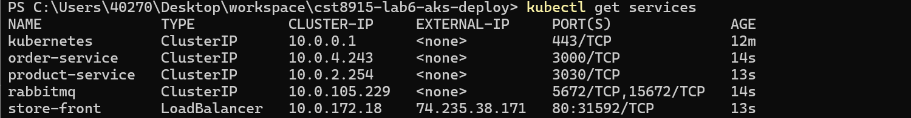

#### 3.2.6 Services in the Portal

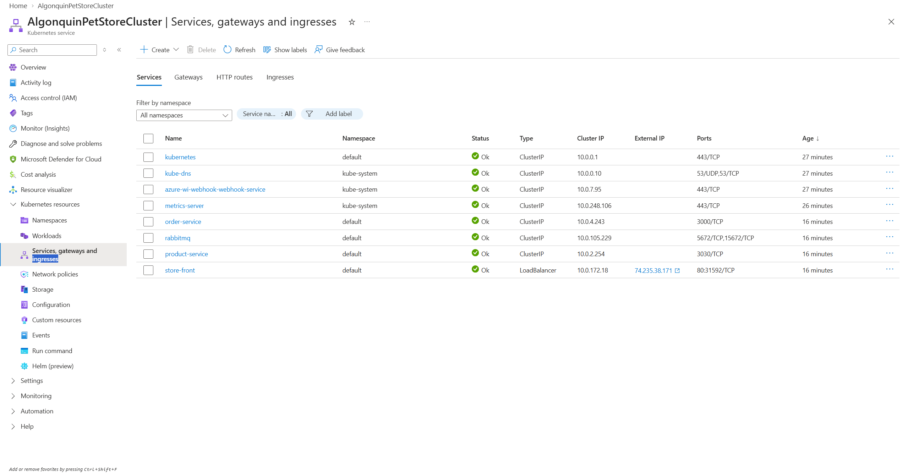

#### 3.2.7 Store Front


#### 3.2.8 Products


#### 3.2.9 RabbitMQ Overview

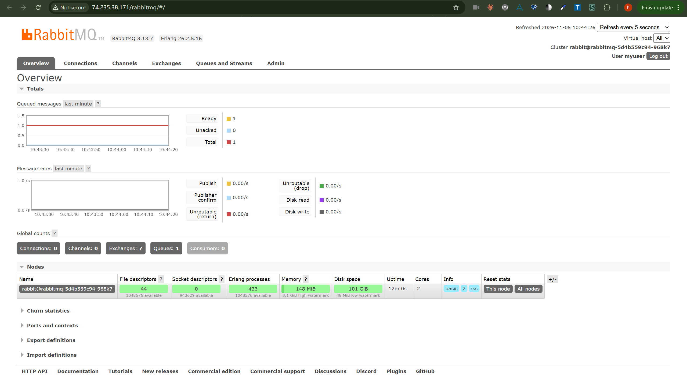

#### 3.2.10 RabbitMQ Queue


### 3.3 Explore Kubernetes

#### 3.3.1 `kubectl get pods -o wide`

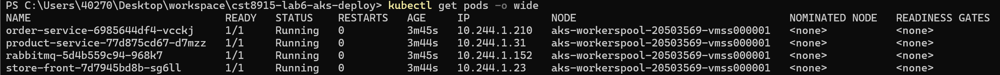

#### 3.3.2 `kubectl get pods --show-labels`

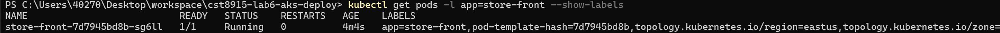

#### 3.3.3 `kubectl scale --replicas=3`

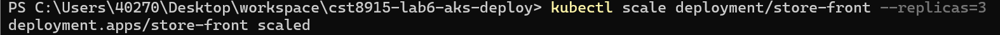

#### 3.3.4 `kubectl rollout status`

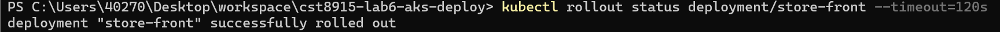

#### 3.3.5 `kubectl get pods -l app=store-front -o wide`

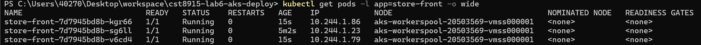

#### 3.3.6 `kubectl get service store-front`

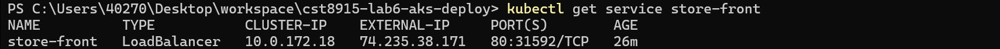

#### 3.3.7 `kubectl get pods --watch`

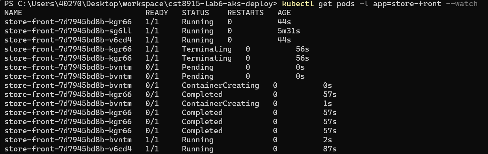

#### 3.3.8 `kubectl delete pod`

This capture repeats the delete on the remaining Pod; the watch above shows the first delete.

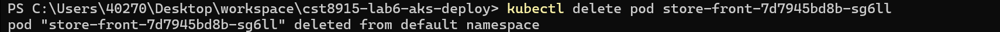

#### 3.3.9 `kubectl logs`

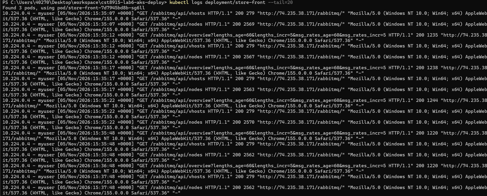

#### 3.3.10 `kubectl scale --replicas=1`

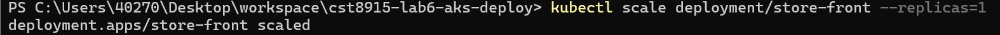

#### 3.3.11 `kubectl get pods -l app=store-front`

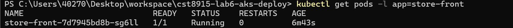

#### 3.3.12 `kubectl rollout status`, after scaling down


### 3.4 kubectl Cheat Sheet

#### 3.4.1 `kubectl get all`

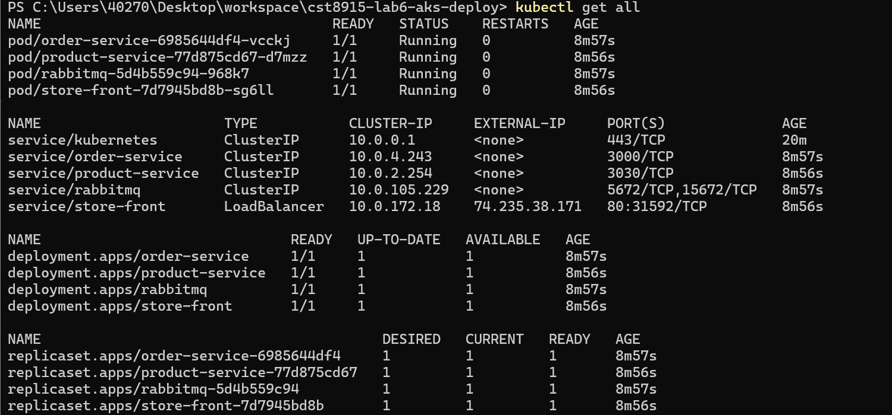

#### 3.4.2 `kubectl describe svc`

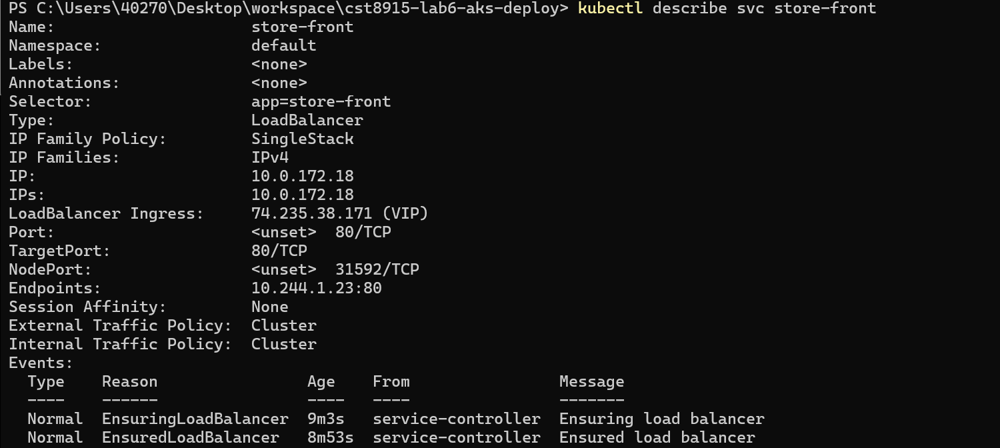

#### 3.4.3 `kubectl top nodes`

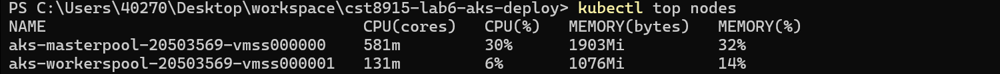

---

## Submission Details

| Item | Value |
|---|---|
| Cluster region | East US, because Standard_D2as_v4 is not available to this subscription in Canada Central |
| Resource group region | Canada Central |
| Node pools | `masterpool` (System) and `workerspool` (User), each 1 node of Standard_D2as_v4 |
| Manifest | `algonquin-pet-store-all-in-one.yaml` |

GenAI declaration: As permitted for labs in this course, Claude (Anthropic) was used to explain the steps, check portal settings and terminal output, and draft this README. The portal steps, commands and demo recording were done by the student.
